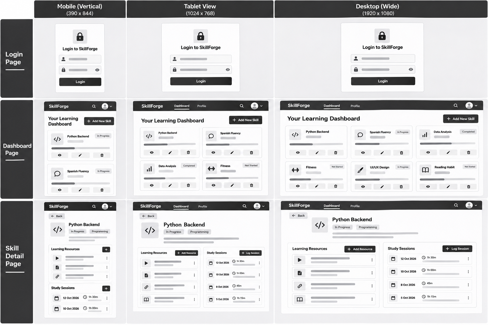
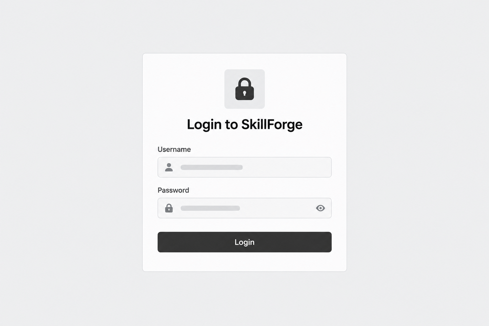
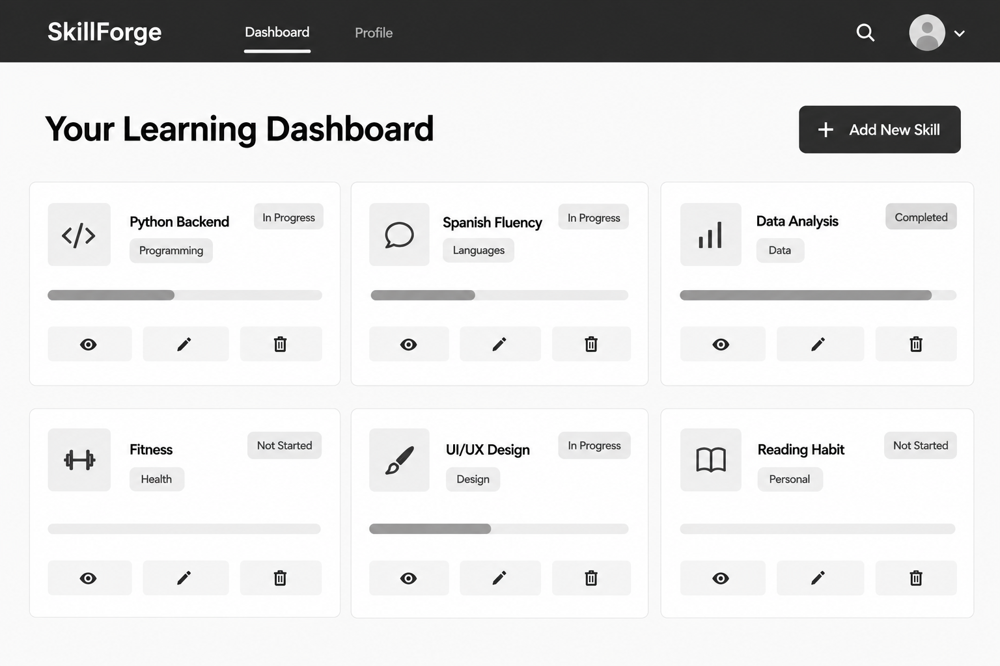
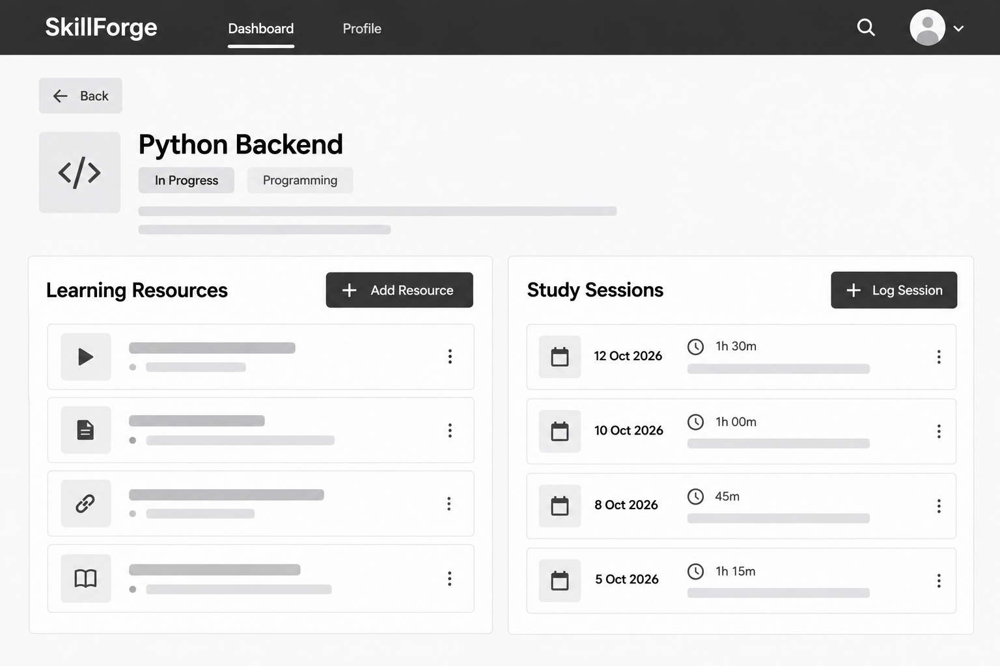

# SkillForge 

[View Live Website](#) [https://skillforge-uwws.onrender.com](https://skillforge-uwws.onrender.com)

SkillForge is a full-stack web application built using Python and Django. It is designed to act as a centralized personal learning hub where users can track technical skills, organize and evaluate learning resources (such as documentation, courses, and videos), and log timed study sessions to monitor progress over time.


## Table of Contents
1. [UX & UI Design](#ux--ui-design)
2. [User Stories](#user-stories)
3. [Features](#features)
4. [Database Schema & Architecture](#database-schema--architecture)
5. [Technologies Used](#technologies-used)
6. [Testing](#testing)
7. [Deployment](#deployment)
8. [Credits & Acknowledgements](#credits--acknowledgements)


## UX & UI Design

### Project Goals
* Provide a clean, intuitive, and distraction-free interface for learners to organize self-directed education.
* Enable full CRUD (Create, Read, Update, Delete) management of skills, learning resources, and study logs.
* Implement robust user authentication to ensure each user's data remains private and secure.

### Target Audience
* Students, software developers, and lifelong learners who want a structured way to track what they are learning and measure their study habits.
* Users who prefer a minimalist, responsive web app over complex spreadsheets or scattered bookmark folders.

### Design & Styling Choices
* **Framework:** Built using **Bootstrap 5** to ensure a responsive grid layout that adapts seamlessly to mobile, tablet, and desktop screens.
* **Color Palette:** Professional dark navigation bar paired with clean, light backgrounds (`#f8f9fa`) and subtle card shadows to maintain a modern, clean aesthetic.
* **Typography:** Clean system sans-serif fonts for optimal legibility across all devices.

### Wireframes
Wireframes were planned prior to development to establish the layout and responsive design across mobile, tablet, and desktop viewports:

* **Complete Responsive Grid Overview:**
  

* **Login Page:**
  

* **Dashboard View:**
  

* **Skill Detail View:**
  


## User Stories

To guide the development of SkillForge, user stories were defined and categorized into target groups:

### First-Time / New Users
* As a new user, I want to easily register or log in so that my personal skills and study logs are secure.
* As a new user, I want a clean dashboard that explains the purpose of the app and prompts me to add my first skill.

### Returning Users
* As a returning user, I want to view a dashboard of all my tracked skills with status badges (e.g., *In Progress*, *Mastered*) so I can check my progress at a glance.
* As a returning user, I want to click into a specific skill to view its associated resources and study sessions.

### Frequent / Power Users
* As a power user, I want to add new learning resources with URLs and notes directly to a skill detail page.
* As a power user, I want to log study sessions with duration times and reflections.
* As a power user, I want to update or delete skills, resources, and sessions whenever my learning goals change.


## Features

###  Authentication & Security
* Secure user login and logout system powered by Django's built-in auth views.
* Route protection (`@login_required`) ensuring users can only access and modify their own data.
* Environment variable management using `python-dotenv` to safeguard secret keys and database settings.

###  Dashboard & Skill Management
* **Dashboard View:** Displays all user-owned skills organized neatly into Bootstrap cards with category and status indicators.
* **Skill Creation & Editing:** Dedicated forms to create new skills or update existing titles, descriptions, and statuses.
* **Deletion Protection:** Confirmation screens before deleting any skill or related record.

###  Resources & Study Logs
* **Resource Tracking:** Attach links, resource types (Article, Video, Course, Book), and personal notes to any skill.
* **Study Session Logging:** Track time spent studying by recording dates, session durations in minutes, and reflection notes.


## Database Schema & Architecture

SkillForge uses Django's Object-Relational Mapper (ORM) with an SQLite database during development and is fully compatible with PostgreSQL in production.

* **User Model:** Built-in Django `User` model.
* **Category Model:** Represents broad topics (e.g., *Programming*, *Languages*, *Design*).
* **Skill Model:** Linked to a User via a Foreign Key (`user = models.ForeignKey(User, on_delete=models.CASCADE)`). Fields include `title`, `description`, `status`, and `created_at`.
* **Resource Model:** Linked to a Skill via a Foreign Key (`skill = models.ForeignKey(Skill, on_delete=models.CASCADE)`). Fields include `title`, `url`, `resource_type`, and `notes`.
* **StudySession Model:** Linked to a Skill via a Foreign Key (`skill = models.ForeignKey(Skill, on_delete=models.CASCADE)`). Fields include `date`, `duration_minutes`, and `reflection_notes`.


## Technologies Used

* **Languages:** Python 3.13, HTML5, CSS3
* **Framework:** Django 6.1 (Web Framework)
* **Frontend Styling:** Bootstrap 5 (CSS framework & bundle scripts)
* **Database:** SQLite (Development) / PostgreSQL-ready (`dj-database-url`)
* **Production Utilities:** Gunicorn (WSGI HTTP server), WhiteNoise (Static file management)
* **Version Control:** Git & GitHub


## Testing

Testing was performed continuously throughout development, mapping features directly back to the initial user stories:

| Test Case | Expected Outcome | Pass/Fail |
| :--- | :--- | :--- |
| **User Authentication** | Unauthenticated users trying to visit `/` are redirected to the login page. | **PASS** |
| **Dashboard Loading** | Logged-in users see their specific skills displayed in responsive cards. | **PASS** |
| **Create Skill** | Submitting the skill form adds a new record to the database and redirects to the dashboard. | **PASS** |
| **Add Resource/Session** | Filling out resource/session forms on a skill detail page successfully saves the record and updates the view. | **PASS** |
| **Delete Confirmation** | Clicking delete prompts a confirmation screen; confirming successfully removes the record. | **PASS** |
| **Responsive Layout** | Navigation bar and cards collapse and rearrange correctly on mobile screens. | **PASS** |

### Known Bugs & Resolved Issues

During development, several technical challenges were identified and resolved:

* **Module Imports Issue (`ModuleNotFoundError: No module named 'skill_tracker'`):**
  * *Issue:* Initial routing configuration pointed to `skill_tracker.urls`, but the application directory was named `skills`.
  * *Fix:* Updated `skillforge_project/urls.py` and `settings.py` (`INSTALLED_APPS`) to reference `skills` uniformly across the project.
* **Unstyled Admin Logout Screen:**
  * *Issue:* Triggering the built-in Django logout view initially rendered Django's unstyled default admin template.
  * *Fix:* Created a custom `logged_out.html` template extending `base.html` with Bootstrap styles and configured `LOGOUT_REDIRECT_URL = 'login'` in `settings.py`.


## Deployment

The project was deployed to Heroku (or Render) following these production steps:

1. Installed production packages (`gunicorn` and `whitenoise`) and updated `requirements.txt`.
2. Configured `WhiteNoiseMiddleware` inside `settings.py` for efficient static file handling.
3. Created a `Procfile` in the root directory containing:
   ```text
   web: gunicorn skillforge_project.wsgi:application


## Credits & Acknowledgements

### Code & Frameworks
* **Django Web Framework:** Used as the backend full-stack framework ([Django Project](https://www.djangoproject.com/)).
* **Bootstrap 5:** CSS framework and JavaScript bundle used for responsive layouts and components ([Bootstrap 5 Documentation](https://getbootstrap.com/docs/5.3/getting-started/introduction/)).
* **WhiteNoise:** Middleware used for static file serving in production environments ([WhiteNoise Docs](https://whitenoise.readthedocs.io/)).
* **Gunicorn:** WSGI HTTP Server for UNIX deployment ([Gunicorn Docs](https://gunicorn.org/)).

### Media & Assets
* **Emojis:** Native system emojis utilized for clean UI icon accents across navigation and action buttons.   